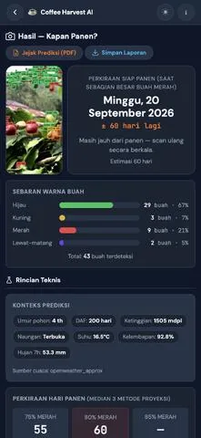
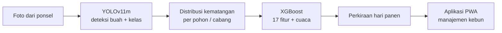
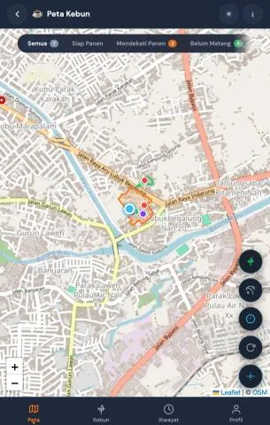
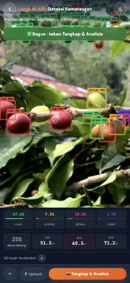

# Coffee Harvest AI — Hybrid YOLOv11 + XGBoost untuk Waktu Panen Kopi Arabika

> Tesis Magister Teknik Informatika, Universitas Putra Indonesia YPTK Padang (2026). Sistem berbasis citra untuk mendeteksi tingkat kematangan buah kopi Arabika dan memprediksi waktu panen optimal, dikembangkan bersama **BRMP Sumatera Barat** dan **Solok Radjo Academy**, dan diuji lapangan di dua lokasi di Solok.

| | |
|---|---|
| Konteks | Tesis S2 + riset di BRMP Sumbar & Koperasi Solok Radjo (Apr – Sep 2026) |
| Peran saya | Peneliti dan pengembang tunggal: dataset, pelatihan model, backend, aplikasi |
| Uji lapangan | Aia Dingin (Solok Radjo Academy) dan Gunung Talang (BRMP Sumbar) |
| Status | Penelitian selesai, prototipe berjalan |

## Hasil

**Deteksi kematangan — YOLOv11m**

| Metrik | Nilai |
|---|---|
| mAP@0.5 | **0.853** |
| mAP@0.5:0.95 | **0.758** |
| Precision | 0.823 |
| Recall | 0.786 |

Dataset: **2.314 citra beranotasi** (dari 901 citra sumber), **4 kelas** kematangan: hijau, kuning, merah, terlalu matang. Dilatih 100 epoch di GPU Tesla T4.

**Prediksi waktu panen — XGBoost**

| Metrik | Nilai |
|---|---|
| MAE | **9,76 hari** |
| RMSE | 12,45 hari |
| R² | **0,857** |
| Prediksi dalam rentang hari | 73,3% |

17 fitur (visual, agronomis, agroklimat), tuning Optuna, validasi silang 5-fold.

## Alur sistem

## Aplikasi pendukung

- **PWA Svelte** dengan wizard 5 langkah: pilih kebun, pohon, cabang, ambil foto, lihat hasil.
- **Manajemen kebun** per pohon dan per cabang dengan peta GPS (PostGIS).
- Riwayat pemindaian dan kurva kematangan.
- **Backend FastAPI** untuk inferensi dan prediksi, migrasi database dengan Alembic.

## Tech stack

| Lapis | Teknologi |
|---|---|
| Deteksi | Ultralytics YOLOv11m, PyTorch, OpenCV |
| Prediksi | XGBoost, Optuna, scikit-learn |
| Backend | FastAPI, Alembic |
| Frontend | Svelte (PWA), TypeScript |
| Data | PostgreSQL + PostGIS |
| Pelatihan | Google Colab (Tesla T4), Jupyter |
| Deploy | Docker Compose, Nginx |

## Galeri

| | |
|---|---|
|  |  |

Riset terkait: [yolov11-cabai](https://github.com/izanmaizan/yolov11-cabai) · [grade-coffee](https://github.com/izanmaizan/grade-coffee) · [PPE-Detection-YOLOv8](https://github.com/izanmaizan/PPE-Detection-YOLOv8)

---

> **Catatan kerahasiaan.** Kode sumber aplikasi ini private karena milik/dipakai instansi. Repo ini hanya menjelaskan konteks, fitur, arsitektur, dan peran saya. Tidak ada kode, data pegawai, data pasien, alamat server, maupun kredensial di sini.

**Maizan Insani Akbar** · Software Engineer & System Analyst · [Portfolio](https://izanmaizan.vercel.app) · [LinkedIn](https://www.linkedin.com/in/izanmaizan/) · [GitHub](https://github.com/izanmaizan)
